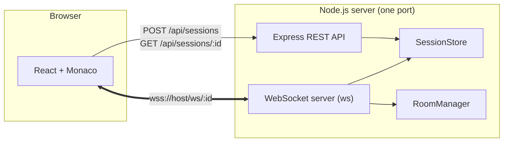
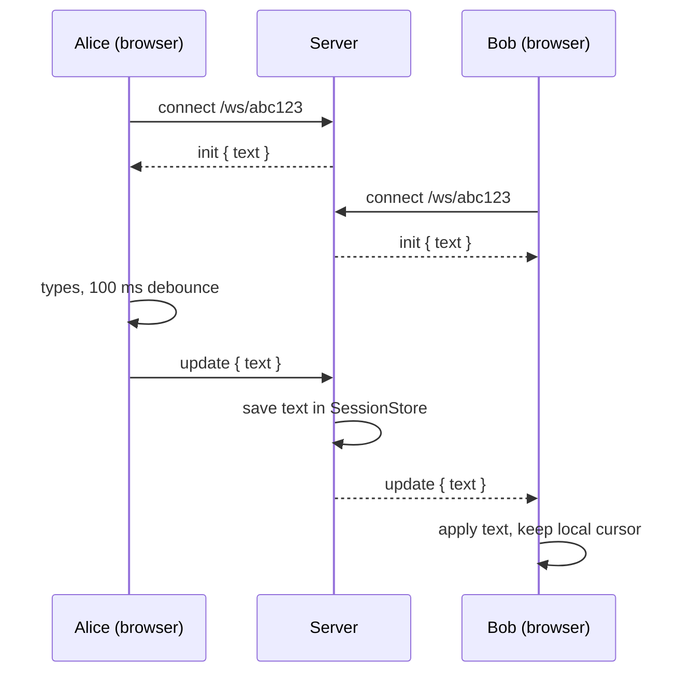

<div align="center">

# shareX

**A real-time collaborative code editor. Create a session, share the link, and type together.**

### [Live demo: sharex-9ai5.onrender.com](https://sharex-9ai5.onrender.com)

<sub>Hosted on Render's free plan. After a period of inactivity the first load can take up to a minute while the server wakes up.</sub>


</div>

---

## Why this project

Pair programming, interviews and quick debugging sessions all start the same way: someone pastes code into a chat and the other person edits a copy. shareX removes that step. Open a link and you are in the same editor as everyone else, with no signup.

It is built from scratch on plain WebSockets, without a collaboration framework. The goal is to understand each layer: sessions, rooms, the HTTP-to-WebSocket upgrade, editor integration and the problems that come with concurrent edits.

## Features

- **Short 4-digit codes**: a new session gets a code like `4580` and a link (`/4580`). Anyone can join by typing the code on the home page.
- **Live sync**: text typed in one tab appears in every other tab of the same session within about 100 ms.
- **Late joiners catch up**: anyone who opens the link receives the current document immediately.
- **Monaco editor**: the editor from VS Code, with syntax highlighting for 10 languages and a language switcher.
- **Connection status**: a live badge shows connecting / connected / reconnecting, and the client reconnects on its own.
- **Isolated rooms**: each session is its own room, and updates never leak between sessions.
- **Cursor-friendly updates**: remote changes keep your cursor where it was instead of throwing it to the top.
- **Built-in limits**: capped sessions, people per session and document size, rate limiting on creating and joining, and idle sessions expire automatically.
- **Clear errors**: a full session or an oversized paste shows a message instead of failing silently.

## Architecture



Express and the WebSocket server share a single HTTP server. A WebSocket connection starts as an HTTP request with an `Upgrade` header. The server checks the URL (`/ws/<id>`), rejects it with `404` if the session does not exist, and otherwise completes the upgrade and adds the socket to that session's room.

### How a keystroke travels



### WebSocket protocol

| Direction | Message |
|---|---|
| Server → client, on connect | `{ "type": "init", "text": "..." }` |
| Client → server | `{ "type": "update", "text": "..." }` |
| Server → other clients in the room | `{ "type": "update", "text": "..." }` |
| Server → client, on a problem | `{ "type": "error", "code": "too-large" \| "room-full", "max": n }`; a full room is then closed with code `4001` |

### REST API

| Method | Path | Response |
|---|---|---|
| `POST` | `/api/sessions` | `201` `{ "id": "4580" }`, `429` when rate limited, `503` when the server is full |
| `GET` | `/api/sessions/:id` | `200` `{ "id", "createdAt" }`, `404`, or `429` when rate limited |
| `GET` | `/api/health` | `200` `{ "ok": true }` |

## Tech stack

| Layer | Choice | Why |
|---|---|---|
| Language | TypeScript (strict) | Catches message-shape and null bugs at compile time |
| Server | Node.js, Express | Small REST surface, easy to reason about |
| Realtime | `ws` | Plain WebSockets, no hidden abstraction over rooms or reconnects |
| IDs | `crypto.randomInt` | Short 4-digit codes that are easy to say out loud, protected by limits and expiry |
| Client | React, Vite, React Router | Fast dev loop, simple routing between home and session |
| Editor | Monaco (`@monaco-editor/react`) | The VS Code editor component |
| Repo | npm workspaces | One install and one repo for `server` and `client` |

## Getting started

**Requirements:** Node.js 22 (developed on v22.18) and npm.

```bash
git clone https://github.com/anandprabhat15/shareX.git
cd shareX
npm install

# terminal 1: API and WebSocket server on http://localhost:3001
npm run dev:server

# terminal 2: client on http://localhost:5173
npm run dev:client
```

Open <http://localhost:5173>, press **New session**, then open the same URL in a second tab or on another device on your network and start typing.

In development, Vite proxies `/api` and `/ws` to the server, so the browser only talks to one origin.

### Configuration

| Variable | Where | Default | Purpose |
|---|---|---|---|
| `PORT` | server | `3001` | Port the server listens on |
| `MAX_SESSIONS` | server | `5000` | Live sessions allowed at once |
| `SESSION_IDLE_MINUTES` | server | `30` | Idle time after which an empty session expires |
| `MAX_CLIENTS_PER_ROOM` | server | `20` | People allowed in one session |
| `CREATE_LIMIT_PER_MIN` | server | `10` | Sessions one client can create per minute |
| `LOOKUP_LIMIT_PER_MIN` | server | `30` | Joins and lookups one client can make per minute |
| `MISS_LIMIT_PER_MIN` | server | `300` | Failed lookups allowed across all clients per minute (slows code guessing) |
| `API_TARGET` | client (dev) | `http://localhost:3001` | Where the Vite dev proxy forwards `/api` and `/ws` |
| `VITE_WS_URL` | client (build) | same origin | WebSocket base URL when the server is hosted separately, e.g. `wss://api.example.com` |

### Production build

```bash
npm run build   # builds the client (client/dist) and compiles the server (server/dist)
npm start       # serves the API, WebSocket and the built client from one port
```

In production the server also serves the built client, so the whole app is one process on one origin. No CORS setup and no `VITE_WS_URL` is needed.

### Testing

```bash
npm run test:e2e
```

End-to-end tests in [`scripts/e2e-test.mjs`](scripts/e2e-test.mjs) run against the real server over HTTP and WebSocket. They cover:

- **REST**: health check, creating sessions with 4-digit codes, and lookups for valid and unknown codes.
- **Live sync**: initial text, broadcast without echo to the sender, late joiners, room isolation, rejected unknown sessions and malformed messages.
- **Every limit**: document size, room size (close code `4001`), create rate, lookup rate (including the WebSocket upgrade), the global wrong-code limit and the session cap.
- **Idle expiry**: empty sessions expire, while sessions with someone connected stay.

The script starts its own server on a free port with small limits (for example 3 people per room and a 3-second idle timeout), restarts it between test groups so rate limits don't interfere, and always stops it at the end. It uses only Node 22 built-ins and the project's own `tsx`, so there is nothing extra to install.

### Deploy

The repository includes a [Render](https://render.com) blueprint ([`render.yaml`](render.yaml)) for a single free web service:

1. In Render choose **New → Blueprint** and select this repository.
2. Render runs `npm ci --include=dev && npm run build`, starts the app with `npm start` and health-checks `/api/health`.

The live demo runs this way. On Render's free plan the service sleeps after about 15 minutes without traffic, so the first request after a pause can take 30 to 60 seconds. Sessions are kept in memory, so they are cleared whenever the service restarts or sleeps.

## Project structure

```
shareX/
├── server/
│   └── src/
│       ├── index.ts        # Express routes, static client, HTTP server, WebSocket upgrade and messages
│       ├── config.ts       # Limits, read from environment variables
│       ├── rateLimit.ts    # RateLimiter and client IP detection
│       ├── sessions.ts     # SessionStore: 4-digit codes, capacity, idle expiry
│       └── rooms.ts        # RoomManager: join, leave, broadcast
├── client/
│   └── src/
│       ├── pages/          # Home (create session) and SessionPage (editor shell)
│       └── components/
│           └── CollabEditor.tsx   # Monaco + WebSocket sync, debounce, reconnect
├── scripts/
│   └── e2e-test.mjs        # End-to-end tests: npm run test:e2e
├── render.yaml             # Render blueprint (single web service)
└── docs/screenshot.jpg
```

## Design decisions

- **Sessions and rooms are separate classes.** `SessionStore` owns the data and `RoomManager` owns live connections. Replacing the in-memory `Map` with Redis or a database only touches one of them.
- **Debounced full-text updates.** Each message carries the whole document, which keeps the protocol and the code small. A 100 ms debounce collapses a burst of keystrokes into one message.
- **No echo loop.** When a remote update is written into the editor, a flag stops Monaco's change event from sending it straight back to the server.
- **Short public codes, protected by limits.** There are only 10,000 four-digit codes, so they can be guessed. The server makes that slow and noisy instead of pretending it is impossible: per-client and global rate limits on lookups, a cap on live sessions and idle expiry that frees codes quickly.
- **Errors over silent drops.** The server tells the client when an update is too large or a room is full, so the UI can explain it.
- **One port for REST and WebSocket.** Simpler to deploy and to proxy, and it fits platforms that expose a single port.

## Known limitations

These are deliberate trade-offs of the current version, not bugs.

- **Simultaneous typing is last-write-wins.** Because each update replaces the whole text, if two people type at the same instant, the update that reaches the server last wins and the other person's keystrokes in that window can be lost. Fixing this properly needs a CRDT or operational transform (see the roadmap).
- **The language selector is local.** Each user picks their own syntax highlighting; it is not synced between participants.
- **Sessions live in memory.** Restarting the server clears all sessions.
- **Codes are public.** Anyone who guesses or is given a code can read and edit the session, so do not paste secrets. Password-protected private sessions are on the roadmap.
- **Rate limits assume one server.** Counters live in memory and the client IP is read from `X-Forwarded-For`, which is good enough for a demo but not for a multi-instance deployment.

## Roadmap

- [x] Session creation and REST API
- [x] WebSocket rooms with live sync
- [x] Monaco client with language switcher and reconnect
- [ ] Private sessions protected by a password and a long unguessable ID (bcrypt hash, short-lived join token)
- [x] Short 4-digit session codes with a join-by-code box
- [x] Limits and cleanup: max sessions, max users per room, rate limiting, expiry of idle sessions
- [x] Hosted demo on Render (single free web service)
- [ ] CRDT-based sync with [Yjs](https://yjs.dev) to merge concurrent edits and add remote cursors
- [x] End-to-end tests for sync, limits and expiry
- [ ] Persistence (Redis or a database)

## Author

Built by [Anand Prabhat](https://github.com/anandprabhat15).
