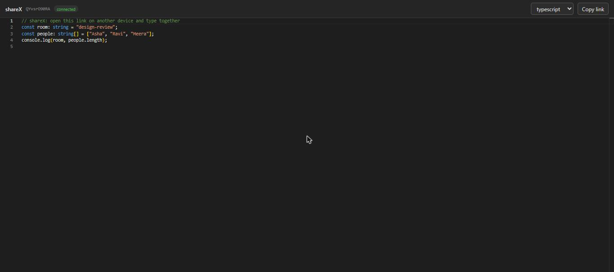
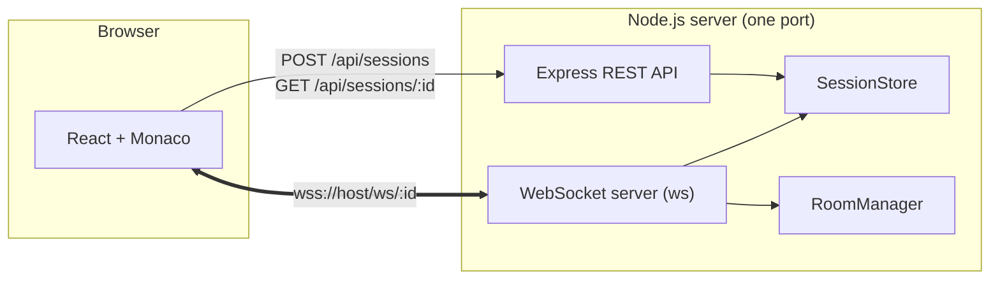
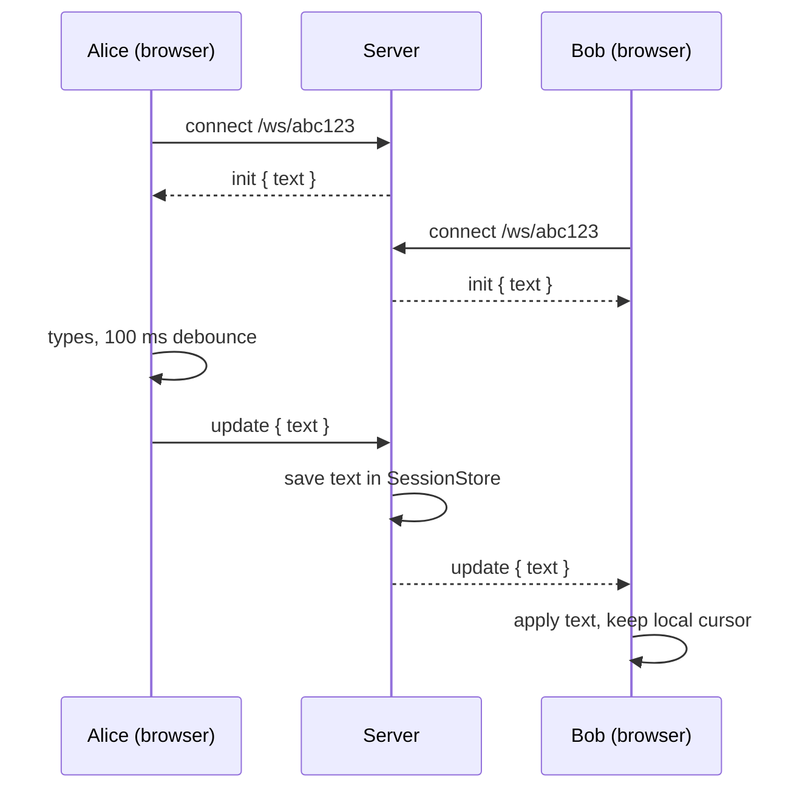

<div align="center">

# shareX

**A real-time collaborative code editor. Create a session, share the link, and type together.**




</div>

---

## Why this project

Pair programming, interviews and quick debugging sessions all start the same way: someone pastes code into a chat and the other person edits a copy. shareX removes that step. Open a link and you are in the same editor as everyone else, with no signup.

It is built from scratch on plain WebSockets, without a collaboration framework. The goal is to understand each layer: sessions, rooms, the HTTP-to-WebSocket upgrade, editor integration and the problems that come with concurrent edits.

## Features

- **One-click sessions**: a new session gets a random 10-character ID and a shareable URL (`/s/<id>`).
- **Live sync**: text typed in one tab appears in every other tab of the same session within about 100 ms.
- **Late joiners catch up**: anyone who opens the link receives the current document immediately.
- **Monaco editor**: the editor from VS Code, with syntax highlighting for 10 languages and a language switcher.
- **Connection status**: a live badge shows connecting / connected / reconnecting, and the client reconnects on its own.
- **Isolated rooms**: each session is its own room, and updates never leak between sessions.
- **Cursor-friendly updates**: remote changes keep your cursor where it was instead of throwing it to the top.
- **Defensive server**: unknown sessions are rejected at the WebSocket handshake, malformed messages are ignored, and document size is capped.

## Architecture



Express and the WebSocket server share a single HTTP server. A WebSocket connection starts as an HTTP request with an `Upgrade` header. The server checks the URL (`/ws/<id>`), rejects it with `404` if the session does not exist, and otherwise completes the upgrade and adds the socket to that session's room.

### How a keystroke travels



### WebSocket protocol

| Direction | Message |
|---|---|
| Server → client, on connect | `{ "type": "init", "text": "..." }` |
| Client → server | `{ "type": "update", "text": "..." }` |
| Server → other clients in the room | `{ "type": "update", "text": "..." }` |

### REST API

| Method | Path | Response |
|---|---|---|
| `POST` | `/api/sessions` | `201` `{ "id": "..." }` |
| `GET` | `/api/sessions/:id` | `200` `{ "id", "createdAt" }`, or `404` |
| `GET` | `/api/health` | `200` `{ "ok": true }` |

## Tech stack

| Layer | Choice | Why |
|---|---|---|
| Language | TypeScript (strict) | Catches message-shape and null bugs at compile time |
| Server | Node.js, Express | Small REST surface, easy to reason about |
| Realtime | `ws` | Plain WebSockets, no hidden abstraction over rooms or reconnects |
| IDs | `nanoid(10)` | Unguessable URLs, so the link itself is the access key |
| Client | React, Vite, React Router | Fast dev loop, simple routing between home and session |
| Editor | Monaco (`@monaco-editor/react`) | The VS Code editor component |
| Repo | npm workspaces | One install and one repo for `server` and `client` |

## Getting started

**Requirements:** Node.js 22 (developed on v22.18) and npm.

```bash
git clone https://github.com/anandprabhat15/shareX.git
cd shareX
npm install

# terminal 1: API and WebSocket server on http://localhost:3001
npm run dev:server

# terminal 2: client on http://localhost:5173
npm run dev:client
```

Open <http://localhost:5173>, press **New session**, then open the same URL in a second tab or on another device on your network and start typing.

In development, Vite proxies `/api` and `/ws` to the server, so the browser only talks to one origin.

### Configuration

| Variable | Where | Default | Purpose |
|---|---|---|---|
| `PORT` | server | `3001` | Port the server listens on |
| `API_TARGET` | client (dev) | `http://localhost:3001` | Where the Vite dev proxy forwards `/api` and `/ws` |
| `VITE_WS_URL` | client (build) | same origin | WebSocket base URL when the server is hosted separately, e.g. `wss://api.example.com` |

### Production build

```bash
npm run build -w server && npm run start -w server   # compiled server
npm run build -w client                              # static files in client/dist
```

## Project structure

```
shareX/
├── server/
│   └── src/
│       ├── index.ts        # Express routes, HTTP server, WebSocket upgrade and message handling
│       ├── sessions.ts     # SessionStore: in-memory sessions
│       └── rooms.ts        # RoomManager: join, leave, broadcast
├── client/
│   └── src/
│       ├── pages/          # Home (create session) and SessionPage (editor shell)
│       └── components/
│           └── CollabEditor.tsx   # Monaco + WebSocket sync, debounce, reconnect
└── docs/screenshot.jpg
```

## Design decisions

- **Sessions and rooms are separate classes.** `SessionStore` owns the data and `RoomManager` owns live connections. Replacing the in-memory `Map` with Redis or a database only touches one of them.
- **Debounced full-text updates.** Each message carries the whole document, which keeps the protocol and the code small. A 100 ms debounce collapses a burst of keystrokes into one message.
- **No echo loop.** When a remote update is written into the editor, a flag stops Monaco's change event from sending it straight back to the server.
- **Random URL as the access key.** There are no accounts. Anyone with the link can join, which matches how tools like this are used.
- **One port for REST and WebSocket.** Simpler to deploy and to proxy, and it fits platforms that expose a single port.

## Known limitations

These are deliberate trade-offs of the current version, not bugs.

- **Simultaneous typing is last-write-wins.** Because each update replaces the whole text, if two people type at the same instant, the update that reaches the server last wins and the other person's keystrokes in that window can be lost. Fixing this properly needs a CRDT or operational transform (see the roadmap).
- **The language selector is local.** Each user picks their own syntax highlighting; it is not synced between participants.
- **Sessions live in memory.** Restarting the server clears all sessions.
- **No access control yet.** Anyone with a session link can read and edit it, so do not paste secrets.
- **No automated tests yet.**

## Roadmap

- [x] Session creation and REST API
- [x] WebSocket rooms with live sync
- [x] Monaco client with language switcher and reconnect
- [ ] Private sessions protected by a password (bcrypt hash, short-lived join token)
- [ ] Limits and cleanup: max sessions, max users per room, rate limiting, expiry of idle sessions
- [ ] Shareable secret code for invite-only access
- [ ] Hosted demo (server on Render, client on Vercel or Netlify)
- [ ] CRDT-based sync with [Yjs](https://yjs.dev) to merge concurrent edits and add remote cursors
- [ ] Persistence (Redis or a database) and automated tests

## Author

Built by [Anand Prabhat](https://github.com/anandprabhat15).
